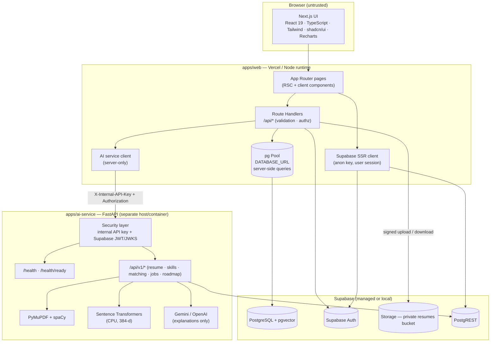
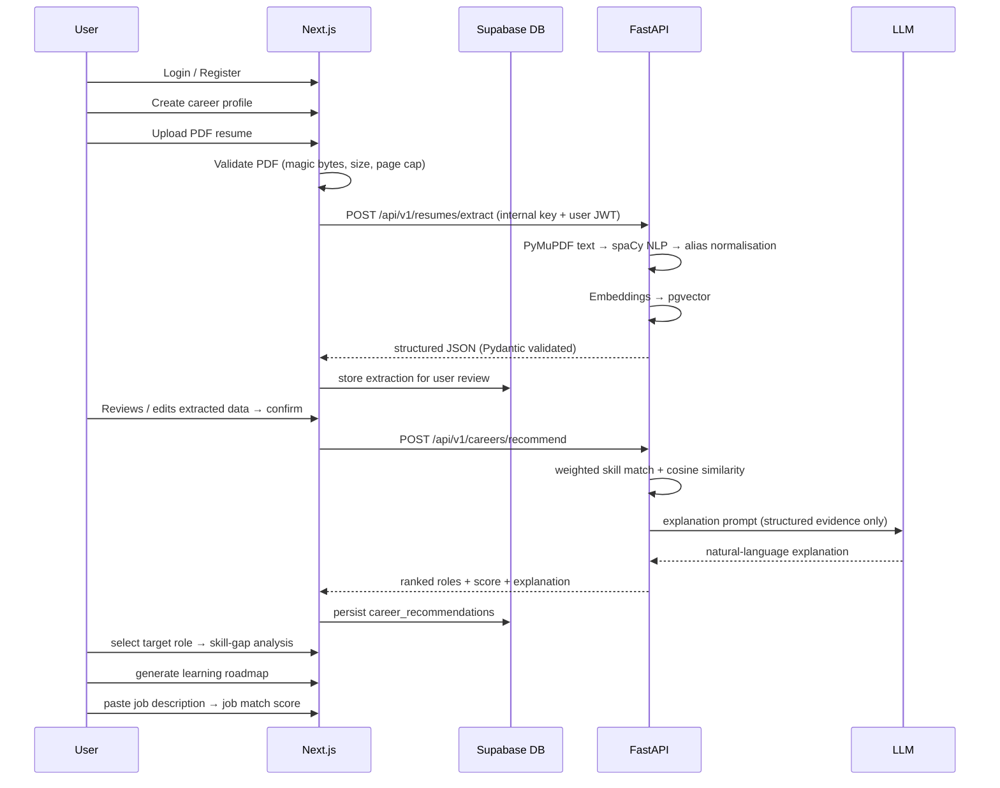

# CareerIQ — System Architecture

> AI Career Intelligence Platform
> Status: **Full M1 workflow built (Phases 1–7) and E2E-verified** — see `docs/development-plan.md`.

## 1. Overview

CareerIQ is a web platform that analyses a user's education, skills, projects, experience,
interests, resume and career goals to produce **personalised career-role recommendations,
resume insights, skill-gap analysis, job-description matching and learning roadmaps**.

It is **not** a chatbot, job portal or recruitment platform. All product decisions follow the
submitted Milestone-1 proposal (problem statement, objectives, scope, methodology).

### Design principles

| Principle | How it is enforced |
|---|---|
| Deterministic scoring | Scores are computed by deterministic code (weighted skill matching + cosine similarity). The LLM only produces natural-language explanations from structured results — it never invents numbers. |
| Server-side secrets | Supabase service-role keys, `DATABASE_URL`, `INTERNAL_API_KEY` and LLM keys exist only in server environments. The browser only ever sees the Supabase anon key. |
| Authorisation at every layer | Row Level Security in Postgres, `user_id` scoping in every query, Supabase session verification in Route Handlers, and service-to-service authentication between Next.js and FastAPI. |
| Honest AI | Extracted resume data is shown back to the user for review before it is used. Recommendations are labelled advisory. Failures (LLM, embedding, extraction) degrade gracefully and are reported as errors, never as fabricated results. |
| Cross-platform | No GPU required. Windows + macOS (incl. Apple Silicon). Docker optional but recommended. |

## 2. Repository layout (monorepo)

```
careeriq/
├── apps/
│   ├── web/                  # Next.js 16 (React 19, TypeScript, Tailwind 4, shadcn/ui, Recharts)
│   │   └── src/
│   │       ├── app/          # App Router pages + Route Handlers (application/API layer)
│   │       ├── components/   # design system (ui/*) + feature components
│   │       ├── lib/          # supabase clients, db pool, validation, matching helpers
│   │       └── styles/       # design tokens (Tailwind 4 @theme)
│   └── ai-service/           # Python FastAPI dedicated processing service
│       └── app/
│           ├── core/         # config, security (JWT/JWKS + internal key), logging
│           ├── api/          # routers (health now; resume/skills/matching/roadmap next)
│           └── services/     # pdf extraction, NLP, embeddings, LLM clients (next phases)
├── supabase/
│   ├── config.toml           # local Supabase stack configuration
│   └── migrations/           # versioned SQL migrations (schema, RLS, seeds)
├── scripts/                  # cross-platform helpers (migrate.mjs)
├── docs/                     # architecture, ERD, API contracts, design system, plan
├── docker-compose.yml        # optional db-only / full-profile containers
└── package.json              # npm workspaces + orchestration scripts
```

## 3. Component diagram



## 4. Trust boundaries & communication security

1. **Browser → Next.js**: only the public anon key and user JWTs travel over the wire.
   Every Route Handler validates the Supabase session (`getUser()`), validates the payload
   with Zod, and scopes every query by `user_id`.
2. **Next.js → FastAPI**: FastAPI is **not** exposed to the browser in production.
   Route Handlers call it server-side with:
   - `X-Internal-API-Key: <INTERNAL_API_KEY>` (service-to-service shared secret), and
   - `Authorization: Bearer <supabase user access token>` for user-scoped operations —
     FastAPI verifies the token signature against Supabase's JWKS (RS256) and checks
     `aud`/`exp`, so a stolen internal key alone cannot impersonate a user.
3. **FastAPI → Supabase**: uses the service-role key (server-side only) or the user's JWT
   via PostgREST; never the anon key for privileged writes.
4. **Resume files**: private Storage bucket, per-user path prefix
   (`{user_id}/{uuid}.pdf`), download only through an authorised Route Handler.
5. **LLM keys**: read from env inside FastAPI; prompts contain only the user's own data;
   responses are parsed as structured JSON and validated with Pydantic.

## 5. Career matching methodology (M1 formula)

```
Career Match Score = (Weighted Matched Skills / Weighted Required Skills) × 100
```

- **Required (mandatory) skills weight = 2.0**, **optional skills weight = 1.0**
  (stored per role in `role_skills.weight` + `is_required`).
- Skill equivalence is handled by `skill_aliases` (e.g. `React.js` ≡ `React` ≡ `ReactJS`).
- Semantic relatedness uses pgvector cosine similarity over 384-d embeddings produced by
  `sentence-transformers/all-MiniLM-L6-v2` for cases where wording differs.
- The deterministic engine produces the score **and** the structured evidence
  (matched / missing skills with weights). The LLM receives that evidence and returns a
  natural-language explanation — it must never compute or alter the score.

## 6. Data flow — the official M1 workflow



## 7. Technology stack (official)

| Layer | Technology |
|---|---|
| Frontend | Next.js 16, React 19, TypeScript 5, Tailwind CSS 4, shadcn/ui, Recharts |
| Application/API | Next.js Route Handlers, server components, Zod validation, Supabase Auth (SSR) |
| Database | Supabase PostgreSQL 16 + pgvector, versioned SQL migrations, RLS |
| AI service | Python 3.12, FastAPI, Pydantic, uvicorn |
| NLP / extraction | PyMuPDF, spaCy |
| Embeddings | Sentence Transformers (CPU), pgvector cosine similarity |
| LLM | Gemini API or OpenAI API (explanations only, structured JSON) |
| Deployment | Vercel (web), managed/ local Supabase, FastAPI host (Railway/Render/Fly/VM), Docker |
| Local dev | Docker Desktop, Supabase CLI, npm workspaces, venv |

## 8. Non-functional requirements

- **Performance**: DB queries indexed; embeddings computed once per artefact and cached in
  pgvector; LLM calls only for explanations; health endpoints < 100 ms excluding AI warm-up.
- **Reliability**: timeouts on all external calls; LLM/embedding failures return typed errors
  (`AI_UPSTREAM_ERROR`) that the UI renders as retryable states — never silent fake data.
- **Privacy**: resume text and profile data are user-scoped; no third-party sharing; LLM
  prompts are opt-in per feature and logged without PII beyond the user's own content.
- **Fairness**: recommendations derive only from declared skills/experience; protected
  characteristics are never inputs; the UI labels results as advisory.
- **Testing**: pytest for FastAPI (health, security, scoring), Vitest for web utilities,
  endpoint smoke tests documented in `docs/development-plan.md`.
