# CareerIQ — Database ERD & Data Model

> PostgreSQL 17 + pgvector, managed by Supabase. Migrations live in
> `supabase/migrations/` and are applied by `npm run db:migrate` (or
> automatically by `npx supabase start`).

## Entity relationship diagram

```mermaid
erDiagram
    users ||--o| profiles : "1:1 career profile"
    users ||--o{ user_skills : owns
    users ||--o{ projects : has
    users ||--o{ experience : has
    users ||--o{ certifications : holds
    users ||--o{ resumes : uploads
    users ||--o{ career_recommendations : receives
    users ||--o{ skill_gap_analyses : runs
    users ||--o{ job_descriptions : analyses
    users ||--o{ job_match_results : receives
    users ||--o{ learning_roadmaps : follows
    users ||--o{ roadmap_progress : tracks

    skills ||--o{ skill_aliases : "alias normalisation"
    skills ||--o{ user_skills : "confirmed by user"
    skills ||--o{ role_skills : "weighted link"
    skills ||--o{ learning_resources : "optional resources"

    career_roles ||--o{ role_skills : requires
    career_roles ||--o{ career_recommendations : scored for
    career_roles ||--o{ skill_gap_analyses : measured against
    career_roles ||--o{ learning_roadmaps : planned for
    career_roles ||--o{ job_match_results : "closest role (nullable)"

    resumes ||--o{ resume_analyses : "1 reviewable extraction"
    resumes ||--o{ resume_analyses : reviewed
    job_descriptions ||--o{ job_match_results : produces
    learning_roadmaps ||--o{ roadmap_progress : per item
    career_recommendations ||--o{ skill_gap_analyses : "linked (nullable)"
```



## Table reference

| Table | Purpose | Key columns |
|---|---|---|
| `users` | Mirror of `auth.users` (trigger `handle_new_user`) | `id`, `email` (citext) |
| `profiles` | Career profile / onboarding | `education jsonb[]`, `interests text[]`, `career_goals text[]`, `experience_level`, `target_role_slug`, `onboarding_complete` |
| `skills` | Skill catalogue (78 seeded + user-added) | `slug` unique, `category`, `embedding vector(384)` |
| `skill_aliases` | Normalisation (React.js = React JS = ReactJS) | `alias_norm` unique |
| `user_skills` | Confirmed user skills | `proficiency`, `source manual\|resume\|import`, `confidence`, `unique(user_id, skill_id)` |
| `projects` / `experience` / `certifications` | Profile detail | `source`, dates with checks |
| `resumes` | Uploaded PDFs (private storage) | `storage_path {user_id}/{uuid}.pdf`, `sha256`, `status` |
| `resume_analyses` | Reviewable extraction JSON | `parsed jsonb`, `reviewed bool` |
| `career_roles` | The ten official M1 roles | `slug`, `onet_codes`, `esco_codes` (imported later) |
| `role_skills` | **M1 weights live here** | `is_required`, `weight` (2.0 required / 1.0 optional) |
| `career_recommendations` | Ranked score set per user | `match_score`, `ranked_position`, `weighted_*`, evidence jsonb, `explanation`, `model_used` |
| `skill_gap_analyses` | Saved gap snapshots | `gap_score`, split evidence, `advice` |
| `job_descriptions` | Pasted JDs | `raw_text`, `extracted_skills jsonb` |
| `job_match_results` | Compatibility per JD | `compatibility_score`, `formula jsonb` |
| `learning_roadmaps` | Generated plan | `plan jsonb = [{week, title, objectives[], items[]}]` |
| `roadmap_progress` | Per-item tracking | `unique(roadmap_id, item_key)` |
| `learning_resources` | Curated resources (seeded later) | `url`, `resource_type` |

## M1 formula storage

`role_skills` defines the official weights:

```sql
required skills  → is_required = true,  weight = 2.0
optional skills  → is_required = false, weight = 1.0

Career Match Score = (weighted matched / weighted required) × 100
```

Both the recommendation engine (`apps/web/src/lib/server/recommendations.ts`)
and the gap engine (`apps/web/src/lib/server/gap.ts`) read these rows — the
number is never computed by the LLM.

## Row Level Security

RLS is enabled on **every** table in `supabase/migrations/20261110000003_rls.sql`
(21 policies). The pattern is uniform:

```sql
create policy ... on public.<table> for all
  using (user_id = (select auth.uid())) with check (user_id = (select auth.uid()));
```

- Reference tables (`skills`, `skill_aliases`, `career_roles`, `role_skills`,
  `learning_resources`) are readable by authenticated users, writable only by
  service role.
- `storage.objects` for the `resumes` bucket is scoped to
  `(storage.foldername(name))[1] = auth.uid()::text` (migration `0005`).
- Server code uses the pool (`DATABASE_URL`, table owner) and still scopes
  every query by `user_id` in application code.
